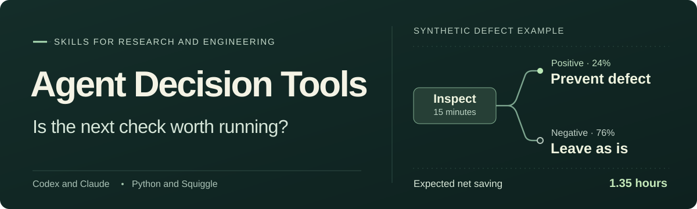

# Agent Decision Tools

Independent skills for research and software engineering, with a local Python API, a JSON CLI and a Squiggle runtime for decisions under uncertainty.

## Choose a skill by need

Each skill can be used on its own. Its description tells the agent when to activate it. A straightforward task can use none. Supporting notes and calculators are there for a specific question that warrants them.

| When this matters | Available skills |
|---|---|
| A decision is unclear or will bind other people | [Clarify the problem](skills/frame-the-problem/SKILL.md) when interpretations change the deliverable. [Record a decision](skills/record-a-decision/SKILL.md) when others need its owner, accepted trade-off and reopening condition. |
| The answer may already exist, or a different mechanism could help | [Find prior evidence or code](skills/gather-what-is-known/SKILL.md). [Transfer a mechanism](skills/transfer-a-mechanism/SKILL.md) when an analogy makes a testable prediction. |
| Credible explanations disagree or more evidence is expensive | [Compare rivals](skills/compare-rival-approaches/SKILL.md) at the outputs that matter. [Design an evidence check](skills/design-an-evidence-check/SKILL.md) when its possible results lead to different actions. |
| A calculation could change the choice | [Use decision tools](skills/agent-decision-tools/SKILL.md) for value of information, regret, stopping or scheduling. [Make a forward estimate in Squiggle](skills/bayesian-fermi-estimation/SKILL.md) for a distribution grounded in historical data or explicit factors. |
| A failure or claim needs verification | [Reproduce a defect](skills/reproduce-a-defect/SKILL.md) at the public boundary. [Evaluate a holdout](skills/evaluate-a-holdout/SKILL.md) under a frozen rule. [Review a consequential claim](skills/review-consequential-claims/SKILL.md) when an error could change a decision. |
| Someone else will use the result | [Deliver a decision or artifact](skills/deliver-for-the-receiver/SKILL.md) with the action and economic threshold. [Handoff for resumption](skills/record-for-resumption/SKILL.md) when another operator needs verified state and a next move. |

## Make selected skills available

From this checkout, link whichever skills a project needs. The command preserves existing installations, can be rerun, and registers no hooks. Use a new session in the destination project to pick up changes.

```sh
python3 scripts/link_skills.py --project /path/to/project --host both compare-rival-approaches reproduce-a-defect
```

Use `--host codex` or `--host claude` for a single host. Use `--user` in place of `--project /path/to/project` to make the selection available across projects. Pass `--all` in place of the names to expose the whole collection. The links point to this checkout, so edits here apply to the linked skills. If a destination already contains a different installation, the command identifies the conflict before creating links. Choose a project-scoped installation or review the existing copy.

The prose skills need only the files in their own directories. The debugging and handoff helpers run on demand with Python 3.12+. The [optional checkpoint hook](skills/record-for-resumption/references/compaction.md) requires separate registration in the project that wants it. For the calculation skills, prepare the runtimes below.

## Run a decision

From this checkout, install the locked dependencies with Python 3.12+ and Node.js 22+.

```sh
uv sync --locked
npm ci --ignore-scripts --prefix skills/bayesian-fermi-estimation
uv run agent-decision-tools run decide examples/defect.json
```

The example inspection costs 0.25 hours. It changes the preferred action to prevention after a positive result and leaves the design alone after a negative result. Its expected value is 1.60 hours gross and 1.35 hours net. All example data are synthetic.

## Choose a calculation

| Question | Operation | Result |
|---|---|---|
| How much could this cost or save? | `fermi` | Runs a forward Squiggle program with a seed and returns quantiles, means and optional draws. |
| Is a pilot, benchmark or follow-up worth its cost? | `decide` | Expected action payoffs, EVPI, optional EVPPI, EVSI, net value, posterior actions and an affordable policy up to two observations deep. |
| Which action holds up across plausible scenarios? | `robust` | Worst payoffs, worst regrets, and the preference threshold in a two-action, two-state problem. |
| How often would a probe need to pay off? | `breakeven` | Minimum success probability from conditional savings and a fixed cost. |
| Do the results clear a predeclared threshold? | `interim` | An exact binomial interval adjusted for the planned looks and a stop, continue or unresolved result. |
| Where do independent judgments differ? | `panel` | Reasons, revisions, probability range, median and equal-weight pool on one binary question. |
| How accurate were our forecasts? | `calibrate` | Paired Brier scores and signed mean errors for each forecaster and for their equal-weight pool. |
| What work fits after reserving time for verification? | `schedule` | OR-Tools selects optional jobs, enforces dependencies and resource limits, and reports solver status. |
| Has a recorded decision reached a reopening condition? | `revisit` | Triggered thresholds, missing observations and an owner/action record. |

## Call from an agent

The [decision-tools skill](skills/agent-decision-tools/SKILL.md) guides an agent through choosing an operation, grounding its inputs and interpreting the result. Its launcher works from a task directory outside this checkout.

```python
import json
from pathlib import Path
from agent_decision_tools import evaluate, schema, tools

operations = tools()
request_shape = schema("decide")
report = evaluate("decide", json.loads(Path("examples/pilot.json").read_text()))
next_step = report["policy"]
```

The CLI exposes the same operations through `list`, `schema NAME` and `run NAME [FILE]`. Omit the file to send JSON on stdin. Every request requires a `basis` naming the evidence or modeling assumptions. Use historical records or the forward Fermi skill to ground material estimates. If a pivotal probability has no defensible basis, calculate the threshold or compare scenarios.

The [worked guide](docs/getting-started.md) connects Squiggle draws to a decision, explains the pilot example and lists the runnable fixtures. The [method catalog](docs/methods.md) maps the earlier tool survey to the implemented routines and specialist packages. The [Fermi skill](skills/bayesian-fermi-estimation/SKILL.md) can also run directly from Codex or Claude.

License notices for adapted material accompany the relevant helpers and are collected under [notices](notices/).
